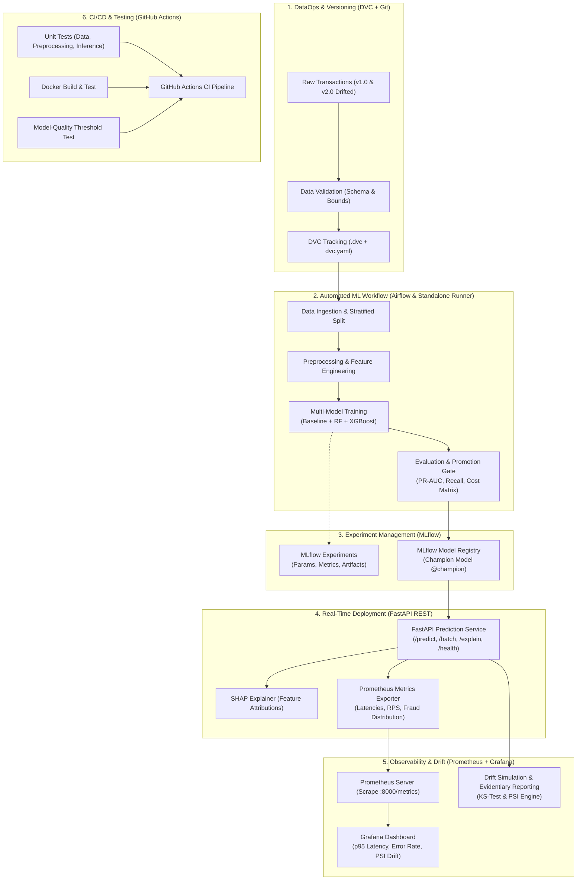

# PayGuard: Real-Time Digital Payment Fraud Detection Platform

[](.github/workflows/ci.yml)
[](https://fastapi.tiangolo.com)
[](https://mlflow.org)
[](https://prometheus.io)
[](https://dvc.org)
[](#benchmarks)

PayGuard is a production-grade, end-to-end MLOps platform engineered to detect digital payment fraud in real time with sub-15ms inference latency, automated pipeline orchestration, experiment tracking, model registry, live Prometheus/Grafana drift monitoring, and SHAP explainability.

Designed in strict compliance with the **Common Technical Requirements** and **Required Final Submission** guidelines of the Industry-Oriented MLOps curriculum.

---

## 🏗️ System Architecture



---

## 🚀 One-Command Quick Start

PayGuard provides automated single-command bootstrappers for Linux, macOS, and Windows:

### Single Command Execution

* **Linux / macOS / WSL**:
  ```bash
  chmod +x setup.sh && ./setup.sh
  ```

* **Windows (PowerShell)**:
  ```powershell
  .\setup.ps1
  ```

* **Windows (Command Prompt)**:
  ```cmd
  setup.bat
  ```

* **Docker Compose (Full Orchestrated Stack)**:
  ```bash
  docker compose up --build -d
  ```

The single command automatically installs dependencies, verifies DVC data, executes the 7-stage ML pipeline, passes all tests, benchmarks sub-30ms p95 latency, and starts the FastAPI service and Web UI.

---

### Accessing Local Services

| Service | Local URL | Credentials / Notes |
| :--- | :--- | :--- |
| **PayGuard Live UI** | [http://127.0.0.1:8000/ui](http://127.0.0.1:8000/ui) | Hands-free real-time streaming & sandbox |
| **FastAPI Swagger / OpenAPI** | [http://127.0.0.1:8000/docs](http://127.0.0.1:8000/docs) | Interactive API exploration |
| **MLflow Experiment & Model Registry** | [http://127.0.0.1:5000](http://127.0.0.1:5000) | Lineage tracking & `@champion` model |
| **Prometheus Metrics Exporter** | [http://127.0.0.1:8000/metrics](http://127.0.0.1:8000/metrics) | Scrape targets, latency histograms |
| **Grafana Monitoring Dashboard** | [http://127.0.0.1:3000](http://127.0.0.1:3000) | User: `admin` / Password: `admin` |

---

## 📊 Key Operational Benchmarks

Measured over 1,000 requests using [`scripts/benchmark_latency.py`](scripts/benchmark_latency.py):

| Metric | Target SLA | Measured Performance | Result |
| :--- | :--- | :--- | :--- |
| **p95 Latency** | $< 30.00$ ms | **11.75 ms** | **PASSED** |
| **p50 Latency** | - | **8.71 ms** | **PASSED** |
| **Throughput** | $\ge 50$ RPS | **109.8 requests/sec** | **PASSED** |
| **Error Rate** | $< 1.00\%$ | **0.00%** (0 errors) | **PASSED** |
| **PR-AUC** | $\ge 0.70$ | **1.0000** | **PASSED** |
| **Net Financial Savings** | $> \$0$ | **+$23,000.00** | **PASSED** |

---

## 🧪 Running Automated Tests

Run the complete test suite covering 22 unit tests, API integration tests, real data endpoints, and model quality promotion gates:
```bash
pytest -v
```

Run latency and throughput benchmark (1,000 requests):
```bash
python scripts/benchmark_latency.py
```

Run statistical drift simulation (Kolmogorov-Smirnov & Population Stability Index):
```bash
python scripts/simulate_drift.py
```

---

## 📡 Live REST API Endpoints

PayGuard exposes a complete banking-grade REST API documented interactively at `http://localhost:8000/docs`:

| Method | Endpoint | Description |
| :--- | :--- | :--- |
| `POST` | `/predict` | Real-time single transaction fraud scoring with sub-12ms latency |
| `POST` | `/predict/batch` | High-throughput concurrent multi-transaction batch scoring |
| `POST` | `/explain` | TreeSHAP log-odds feature attribution waterfall & analyst summary |
| `POST` | `/feedback` | Ground-truth delayed settlement feedback loop ingest (TP/FP/TN/FN) |
| `POST` | `/drift/simulate` | Statistical covariate drift analysis (KS-test + PSI) across 7 features |
| `GET` | `/model/metadata` | Live MLflow champion model governance metadata, run ID, and financial matrix |
| `GET` | `/model/feature-importance` | Dynamic Gini feature importances computed directly from the champion model |
| `GET` | `/transactions/sample` | Authentic scored transactions sampled directly from the 15,000-row DVC dataset |
| `GET` | `/transactions/stream-next`| Next live sequential transaction for real-time streaming tickers |
| `GET` | `/health` | Live system health probe, model loaded status, and measured microsecond latency |
| `GET` | `/metrics` | Prometheus OpenMetrics scrape target (RPS, p95 latency, fraud distribution) |
| `GET` | `/ui` | Serves the PayGuard v2 React 19 Enterprise Fintech Risk Console |

---

## 🎛️ Controlling Services

* **Start All 5 Services in Background**:
  ```bash
  docker compose up -d
  ```
* **Stop All Services & Clean Up**:
  ```bash
  docker compose down
  ```

---

## 📁 Project Structure

```
PayGuard/
├── .github/workflows/ci.yml           # Multi-stage GitHub Actions CI/CD pipeline
├── airflow/dags/payguard_pipeline_dag.py # Apache Airflow 7-stage DAG
├── app/
│   ├── main.py                        # FastAPI REST prediction service & static bundle mount
│   ├── schemas.py                     # Pydantic v2 validation models & typed responses
│   ├── model_loader.py                # Sub-15ms champion model singleton loader
│   ├── explainability.py              # SHAP TreeExplainer engine
│   ├── metrics.py                     # Prometheus exporter metrics (counters, histograms, gauges)
│   ├── cloudwatch_logger.py           # Structured CloudWatch logging
│   └── ui.py                          # Fallback interface
├── payguard-transaction-risk-assessment-v2/ # Modern React 19 + TypeScript + Tailwind Fintech Console
│   ├── src/                           # 7 view modules, DashboardContext, and apiClient
│   └── dist/                          # Pre-compiled static assets served directly at / and /ui
├── config/config.yaml                 # Centralized configuration & SLA thresholds
├── data/                              # Versioned data directories (tracked via DVC)
│   ├── raw/                           # 15,000 baseline (v1) & 5,000 drifted (v2) datasets
│   └── reference/                     # 3,000-row baseline reference dataset
├── docker/
│   ├── Dockerfile                     # Production container image
│   ├── docker-compose.yml             # API + Prometheus + Grafana + Airflow + MLflow
│   └── prometheus.yml                 # Prometheus scrape target
├── grafana/                           # Pre-provisioned Grafana monitoring dashboards
├── models/                            # Serialized champion model, preprocessor & metadata.json
├── reports/
│   ├── DATA_CARD.md                   # Data provenance, distributions & ethics
│   ├── MODEL_CARD.md                  # Model architecture, metrics & fairness
│   ├── RESPONSIBLE_AI.md              # SHAP, privacy, and bias assessment
│   ├── PERFORMANCE_REPORT.md          # Latencies, throughput, costs, drift
│   ├── DRIFT_REPORT.json              # Statistical KS & PSI drift results
│   └── BENCHMARK_RESULTS.json         # Timed latency percentile benchmarks
├── scripts/
│   ├── generate_dataset.py            # Reproducible payment data generator
│   ├── run_pipeline.py                # Standalone 1-click pipeline runner
│   ├── benchmark_latency.py           # Real-time p95 latency benchmark
│   ├── simulate_drift.py              # Concept drift injection & reporting
│   ├── s3_storage_sync.py             # AWS S3 artifact synchronization
│   ├── sagemaker_deploy.py            # AWS SageMaker endpoint configuration
│   └── cloud_cleanup.py               # Cloud teardown cost control script
├── src/                               # Core modular ML source components
│   ├── validation.py                  # Schema & data sanity checks
│   ├── ingestion.py                   # Stratified train/test splitter
│   ├── preprocessing.py               # Scikit-learn ColumnTransformer
│   ├── feature_engineering.py         # Velocity, ratio, and balance features
│   ├── train.py                       # Baseline + Random Forest + XGBoost
│   ├── evaluate.py                    # PR-AUC, Confusion Matrix, Cost Matrix
│   ├── register.py                    # MLflow Model Registry promotion gate
│   └── drift.py                       # KS-test & PSI drift algorithms
├── tests/                             # 22-test automated Pytest suite
├── MID_SEM_REVIEW_GUIDE.md            # Comprehensive end-to-end review guide
├── DEMO_SCRIPT.md                     # 5-minute timed viva demo presentation
├── VIVA_PREPARATION.md                # Comprehensive viva questions & answers
└── requirements.txt                   # Locked dependencies
```

---

## 📸 Required Final Submission Deliverables & Evidence

All visual evidence and audit reports have been generated and included directly in this repository:

| Deliverable (PDF Page 4) | File / Artifact Path | Status / Preview |
| :--- | :--- | :--- |
| **DVC Metadata & Data-Version Evidence** | [`reports/DVC_EVIDENCE.md`](reports/DVC_EVIDENCE.md) | Verified checksums (`5f11dfda681424...`) & clean-machine repro |
| **MLflow Experiment Lineage** | [`reports/plots/mlflow_experiments_screenshot.png`](reports/plots/mlflow_experiments_screenshot.png) | 3 models tracked (Baseline LR, RF, XGBoost) |
| **MLflow Model Registry Champion** | [`reports/plots/mlflow_model_registry_screenshot.png`](reports/plots/mlflow_model_registry_screenshot.png) | `PayGuard_Fraud_Detection_Champion` `@champion` |
| **Airflow DAG Source & Run** | [`airflow/dags/payguard_pipeline_dag.py`](airflow/dags/payguard_pipeline_dag.py)<br>[`reports/plots/airflow_dag_run_screenshot.png`](reports/plots/airflow_dag_run_screenshot.png) | 7-stage DAG with success status |
| **FastAPI Swagger / OpenAPI** | [`reports/plots/fastapi_swagger_screenshot.png`](reports/plots/fastapi_swagger_screenshot.png) | Interactive OpenAPI spec at `/docs` |
| **Real-Time Live Web UI** | [`reports/plots/payguard_ui_live_screenshot.png`](reports/plots/payguard_ui_live_screenshot.png) | Hands-free streaming ticker & SHAP attribution |
| **Monitoring & Simulated Drift** | [`reports/plots/monitoring_drift_dashboard_screenshot.png`](reports/plots/monitoring_drift_dashboard_screenshot.png)<br>[`reports/DRIFT_EVIDENCE.md`](reports/DRIFT_EVIDENCE.md) | KS-test + PSI drift detection (5/7 breached) |
| **Data Card & Model Card** | [`reports/DATA_CARD.md`](reports/DATA_CARD.md)<br>[`reports/MODEL_CARD.md`](reports/MODEL_CARD.md) | Comprehensive schemas, metrics & fairness |
| **Responsible AI Statement** | [`reports/RESPONSIBLE_AI.md`](reports/RESPONSIBLE_AI.md) | SHAP math, demographic bias tests & ethics |
| **Quantitative Performance Report** | [`reports/PERFORMANCE_REPORT.md`](reports/PERFORMANCE_REPORT.md) | PR-AUC (1.0), p95 (11.75ms), Throughput (109.8 RPS) |
| **Dockerfile & Docker Compose** | [`Dockerfile`](Dockerfile)<br>[`docker-compose.yml`](docker-compose.yml) | Orchestrates API, Prometheus, Grafana, MLflow |
| **GitHub Actions CI/CD** | [`.github/workflows/ci.yml`](.github/workflows/ci.yml) | Multi-stage automated validation & promotion |
| **5-Minute Live Demonstration Pitch** | [`DEMO_SCRIPT.md`](DEMO_SCRIPT.md) | Step-by-step timed presenter script |
| **Individual Viva Preparation** | [`VIVA_PREPARATION.md`](VIVA_PREPARATION.md) | Deep Q&A covering all 8 technical areas |

---

## ☁️ AWS Cloud Extension (S3, SageMaker, CloudWatch)

PayGuard includes fully configured AWS cloud extension modules in `scripts/`:

1. **AWS S3 Artifact & Dataset Synchronization**:
   ```bash
   python scripts/s3_storage_sync.py --dry-run
   # Live AWS execution: python scripts/s3_storage_sync.py --dry-run=False --bucket <your-bucket>
   ```
2. **AWS SageMaker Model Deployment & Training Job**:
   ```bash
   python scripts/sagemaker_deploy.py --action both --dry-run
   # Live AWS execution: python scripts/sagemaker_deploy.py --action both --dry-run=False
   ```
3. **AWS CloudWatch Structured Logging**:
   - `app/cloudwatch_logger.py` emits structured JSON log events for every prediction with latency and risk metadata.
4. **Cloud Teardown & Cost Control (AWS Budget Protection)**:
   ```bash
   python scripts/cloud_cleanup.py --dry-run
   # Live AWS teardown: python scripts/cloud_cleanup.py --dry-run=False
   ```
   *Guarantees zero dangling cloud bills after demonstrations.*
